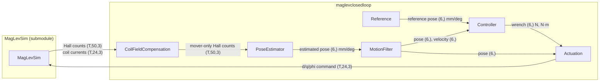
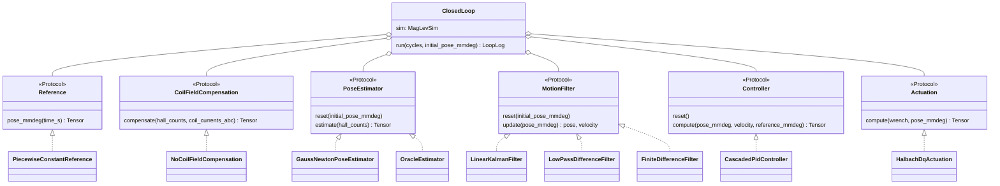
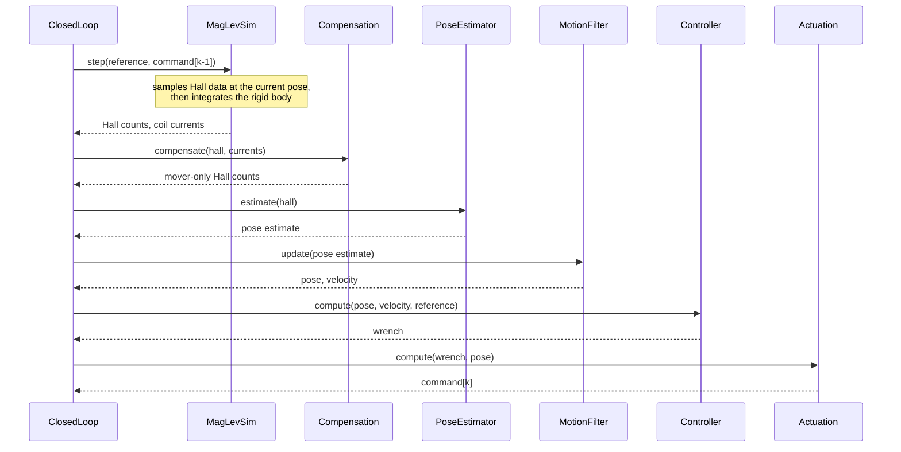
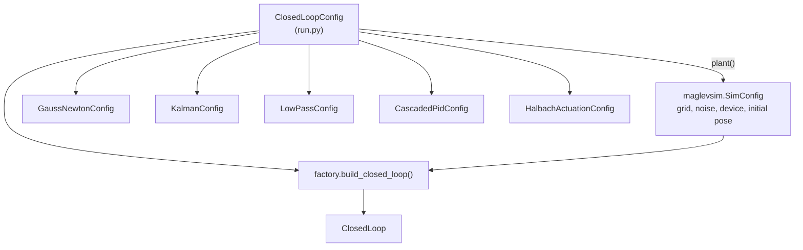

# Architecture

## Goal

The repository closes one control loop around the MagLevSim planar motor with the least code possible.
Every stage of the loop is exchangeable: Hall-field compensation, pose estimation, motion filtering, control, and actuation.
A stage depends only on its interface, never on another concrete stage.

## Components

`T` is the tile count (`grid_rows * grid_cols`).

| Stage | Interface method | Default implementation | Origin |
|---|---|---|---|
| Reference | `pose_mmdeg(time_s)` | `PiecewiseConstantReference` | new |
| Compensation | `compensate(hall, currents)` | `NoCoilFieldCompensation` (pass-through) | new |
| Pose estimation | `estimate(hall)` | `GaussNewtonPoseEstimator` | MagLevPoseEstimation (finite cuboid model with Hall element offsets) |
| Motion filter | `update(pose)` → pose, velocity | `LinearKalmanFilter` (constant velocity), `LowPassDifferenceFilter` or `FiniteDifferenceFilter` | new |
| Control | `compute(pose, velocity, reference)` | `CascadedPidController` | MagLevWhiteBox (`MimoController`) |
| Actuation | `compute(wrench, pose)` | `HalbachDqActuation` | MagLevWhiteBox (`ForceTransform`) |

`OracleEstimator` returns the simulator ground truth (`estimator="oracle"`). Use it to test the other stages without estimation error.

The motion filter supplies the controller with pose and velocity (`motion_filter` switch).
`FiniteDifferenceFilter` passes the pose through and differentiates it; this amplifies estimation noise.
`LowPassDifferenceFilter` smooths that difference with a first-order low-pass (`cutoff_hz`); the pose stays unfiltered.
`LinearKalmanFilter` estimates pose and velocity per axis with a constant-velocity model and smooths the noise.

## Interfaces

The interfaces are `typing.Protocol` classes in `interfaces.py`.
A new stage needs no base class; it needs only the matching method.

## One control cycle (250 µs)

The command of cycle `k` takes effect in cycle `k + 1`. This is one sample of transport delay, as on real hardware.

## Configuration

`ClosedLoopConfig` holds every value a user changes: grid size, initial pose, reference schedule, duration, estimator, and motion filter.
`build_closed_loop` distributes these values to the stage configs.
The initial pose is set once and used for both the simulator reset and the estimator start value.

## Frames and units

| Quantity | Frame and unit |
|---|---|
| Pose at interfaces | global array frame, origin at the lower-left array corner: `[x_mm, y_mm, z_mm, roll_deg, pitch_deg, yaw_deg]` |
| Estimator internals | MagLevSim world frame, origin at the array centre: metres, radians |
| Hall data | counts (20000 per tesla), axis order `[By, Bx, Bz]` |
| Wrench | `[Fx, Fy, Fz]` in N, `[Tx, Ty, Tz]` in N·m |
| Command | per coil `[d_incr, q_incr, electrical_angle_rad]` |

Units change only inside a stage. `plant.py` is the only module that uses MagLevSim internals (geometry helpers).

## Grid size (M x N)

No stage is limited to one tile:

- The estimator uses the sensors of all tiles in one least-squares problem.
- The actuation checks the coils of all tiles against the four Halbach arrays.
- The motion filter and the controller work on the global pose only.

The simulator start-up time grows with the tile count because MagLevSim precomputes the coil-to-sensor sensitivity matrix.

## Exchange a stage

1. Write a class with the interface method (see `interfaces.py`).
2. Construct `ClosedLoop` with it, or change the wiring in `factory.build_closed_loop`.
3. Add its parameters as a frozen dataclass in `config.py` when it has any.
