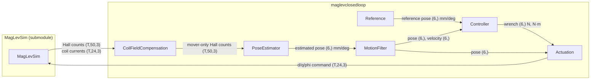
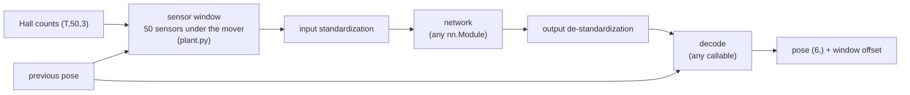
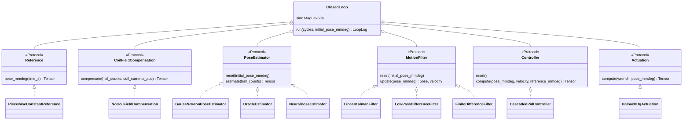
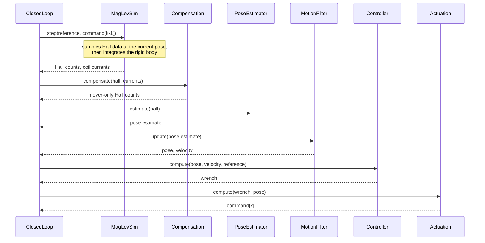
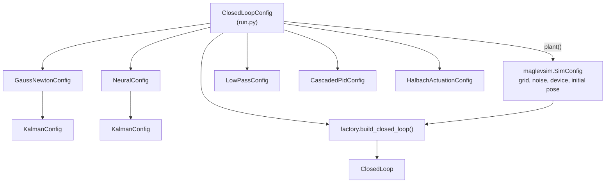

# Architecture

For a short view with only the interfaces, see [architecture_overview.md](architecture_overview.md).

## Goal

The repository closes one control loop around the MagLevSim planar motor with the least code possible.
Every stage of the loop is exchangeable: Hall-field compensation, pose estimation, motion filtering, control, and actuation.
A stage depends only on its interface, never on another concrete stage.

## Components

`T` is the tile count (`grid_rows * grid_cols`).

| Stage | Interface method | Default implementation | Origin |
|---|---|---|---|
| Reference | `pose_mmdeg(time_s)` | `PiecewiseConstantReference` | new |
| Compensation | `compensate(hall, currents)` | `NoCoilFieldCompensation` (pass-through) | new |
| Pose estimation | `estimate(hall)` | `GaussNewtonPoseEstimator` or `NeuralPoseEstimator` | MagLevPoseEstimation (finite cuboid model with Hall element offsets; trained networks) |
| Motion filter | `update(pose)` → pose, velocity | `LinearKalmanFilter` (constant acceleration), `LowPassDifferenceFilter` or `FiniteDifferenceFilter` | MagLevPoseEstimation (`kf_ca_const_*`); low-pass and difference new |
| Control | `compute(pose, velocity, reference)` | `CascadedPidController` | MagLevWhiteBox (`MimoController`) |
| Actuation | `compute(wrench, pose)` | `HalbachDqActuation` | MagLevWhiteBox (`ForceTransform`) |

With `coil_field_in_hall=False` (default) the plant uses `SimConfig.scaling_const_stator = 0`. The Hall data then hold only the mover field; the coil forces stay unchanged. The compensation stage is a pass-through until the coil field is switched on.

`OracleEstimator` returns the simulator ground truth (`estimator="oracle"`). Use it to test the other stages without estimation error.

The motion filter supplies the controller with pose and velocity (`motion_filter` switch).
`FiniteDifferenceFilter` passes the pose through and differentiates it; this amplifies estimation noise.
`LowPassDifferenceFilter` smooths that difference with a first-order low-pass (`cutoff_hz`); the pose stays unfiltered.
`LinearKalmanFilter` estimates pose and velocity per axis with a constant-acceleration (or constant-velocity) model and smooths the noise.

### Kalman filter parameters

The filter is the same as `kf_ca_const_*` in MagLevPoseEstimation (`filtering/ekf.py`): constant acceleration, continuous white-noise process covariance Q, constant measurement covariance R, Joseph-form update. All values are SI (m, rad).

R describes the estimator, so each estimator config holds its own `KalmanConfig`:

| Estimator | Config | Tuned entry in `filter_tuning_seed20261029.json` |
|---|---|---|
| Gauss-Newton (and oracle) | `GaussNewtonConfig.kalman` (= `KalmanConfig` defaults) | `kf_ca_const_cpp_parallel_taylor_1_element_offsets` |
| Neural (log MLP) | `NeuralConfig.kalman` | `kf_ca_const_singleframe_log_mlp_700k` |

The values were fitted in MagLevPoseEstimation on `data/filter_tuning_seed20261029/motion` with 4 counts Hall noise (notebooks `experiments/05_hold_*` and `06_motion_*`): R from the estimator residuals, Q per axis group by minimal rollout RMSE.
The values minimize the open-loop estimation error. In the closed loop their phase lag is too large: with the oracle estimator and these values the mover falls; with Q scaled by 10^6 it hovers but overshoots (z +0.33 mm). Closed-loop values still need tuning.
Differences to the tuned setting: the Gauss-Newton estimator here iterates to convergence instead of one Taylor step; the estimators start from their own previous estimate, not from the filter prediction; the yaw branch alignment is not ported.

## Neural pose estimation

`NeuralPoseEstimator` runs a network trained in MagLevPoseEstimation. It has three exchangeable parts:

| Part | Source | Default |
|---|---|---|
| Network architecture | checkpoint `model` (kind, hidden dims, activation, head) | `PoseMLP`; other kinds raise `NotImplementedError` until ported |
| Weights | checkpoint `state_dict` | loaded strictly |
| Input/output normalization | checkpoint `normalization` | per-component Hall statistics, per-output statistics |
| Output decoding | checkpoint `model.output_dim` and `data.uz_from_tilt` | 8 outputs: body z-axis and 4-fold twist, yaw branch from the previous pose |
| Sensor window | fixed: MagLevSim sensor lattice | window centre nearest the previous pose; works on any M x N grid |
| Hall units and axis order | fixed: training convention | counts, `[By, Bx, Bz]`, no coil field |

`NeuralPoseEstimator.from_checkpoint` reads everything from the checkpoint. To customize, construct `NeuralPoseEstimator(plant, network, normalization, decode)` directly with another network or decoder.

Checkpoints live in `checkpoints/`. `scripts/slim_checkpoint.py` reduces a training checkpoint from MagLevPoseEstimation to the inference part and keeps the run name for provenance.
`checkpoints/logmlp_seed42.pt` is run `final_logmlp_mlp_2048-2048-1024_lr1e-4_cosine1000_seed42_1m` (best model, epoch 1000).

A neural estimator inside a Kalman filter is the combination `estimator="neural"` and `motion_filter="kalman"`; the filter then uses `NeuralConfig.kalman`.

## Interfaces

The interfaces are `typing.Protocol` classes in `interfaces.py`.
A new stage needs no base class; it needs only the matching method.

## One control cycle (250 µs)

The command of cycle `k` takes effect in cycle `k + 1`. This is one sample of transport delay, as on real hardware.

## Configuration

`ClosedLoopConfig` holds every value a user changes: grid size, initial pose, reference schedule, duration, estimator, and motion filter.
`build_closed_loop` distributes these values to the stage configs.
The initial pose is set once and used for both the simulator reset and the estimator start value.

## Frames and units

| Quantity | Frame and unit |
|---|---|
| Pose at interfaces | global array frame, origin at the lower-left array corner: `[x_mm, y_mm, z_mm, roll_deg, pitch_deg, yaw_deg]` |
| Estimator internals | MagLevSim world frame, origin at the array centre: metres, radians |
| Hall data | counts (20000 per tesla), axis order `[By, Bx, Bz]` |
| Wrench | `[Fx, Fy, Fz]` in N, `[Tx, Ty, Tz]` in N·m |
| Command | per coil `[d_incr, q_incr, electrical_angle_rad]` |

Units change only inside a stage. `plant.py` is the only module that uses MagLevSim internals (geometry helpers).

## Grid size (M x N)

No stage is limited to one tile:

- The Gauss-Newton estimator uses the sensors of all tiles in one least-squares problem.
- The neural estimator uses the 50-sensor window under the mover, which can span tiles.
- The actuation checks the coils of all tiles against the four Halbach arrays.
- The motion filter and the controller work on the global pose only.

The simulator start-up time grows with the tile count because MagLevSim precomputes the coil-to-sensor sensitivity matrix.

## Exchange a stage

1. Write a class with the interface method (see `interfaces.py`).
2. Construct `ClosedLoop` with it, or change the wiring in `factory.build_closed_loop`.
3. Add its parameters as a frozen dataclass in `config.py` when it has any.
