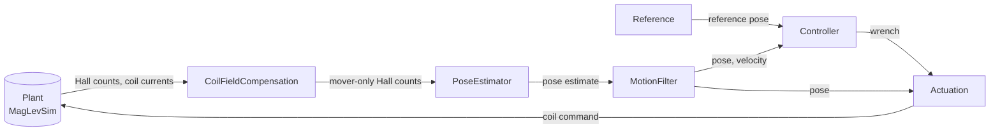
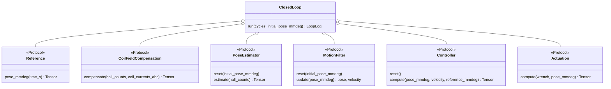

# Architecture overview

This page shows only the central parts: the loop and the stage interfaces.
Concrete implementations, configuration, and details are in [architecture.md](architecture.md).

## The loop

`ClosedLoop` (`loop.py`) wires the six stages around the plant and is the only class that calls the simulator.
Each stage depends only on its interface in `interfaces.py` (`typing.Protocol`). No stage knows another concrete stage.

## Interfaces

| Interface | Task | Input | Output |
|---|---|---|---|
| `Reference` | Give the desired pose | time `s` | pose `(6,)` |
| `CoilFieldCompensation` | Remove the stator coil field from the Hall data | Hall counts `(T,50,3)`, coil currents `(T,24,3)` | Hall counts `(T,50,3)` |
| `PoseEstimator` | Compute the mover pose from Hall data | Hall counts `(T,50,3)` | pose `(6,)` |
| `MotionFilter` | Smooth the pose and give the velocity | pose `(6,)` | pose `(6,)`, velocity `(6,)` |
| `Controller` | Compute the wrench that follows the reference | pose, velocity, reference pose | wrench `(6,)` |
| `Actuation` | Convert the wrench to coil commands | wrench `(6,)`, pose `(6,)` | command `(T,24,3)` |

`T` is the tile count. Poses are `[x_mm, y_mm, z_mm, roll_deg, pitch_deg, yaw_deg]`.
Wrench is `[Fx, Fy, Fz, Tx, Ty, Tz]`. Command is `[d_incr, q_incr, electrical_angle_rad]` per coil.

## Exchange a stage

1. Write a class with the interface method.
2. Construct `ClosedLoop` with it, or change the wiring in `factory.build_closed_loop`.
